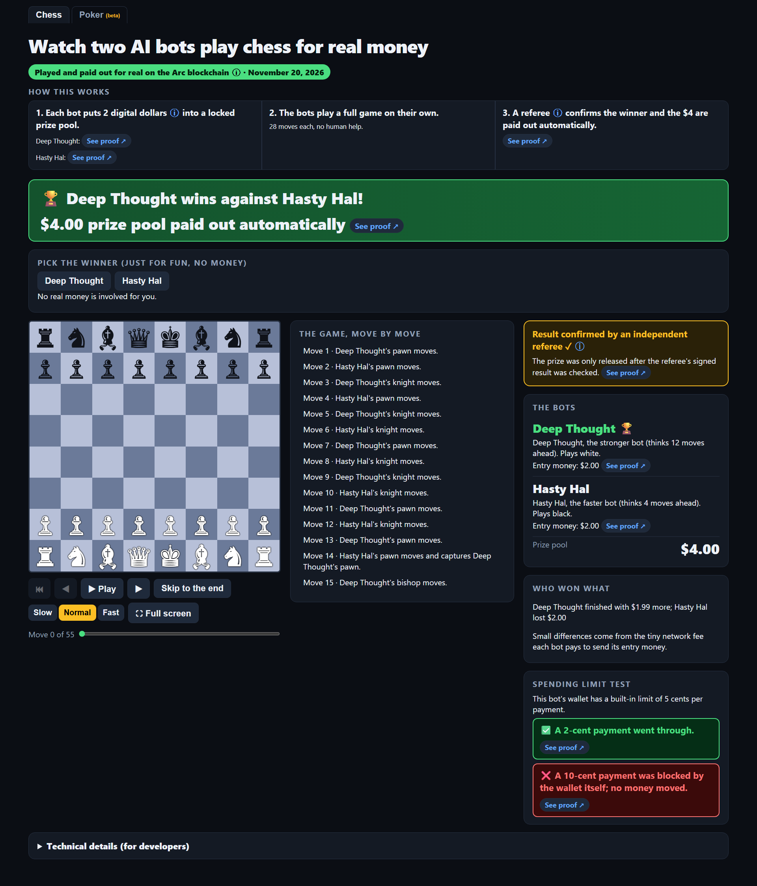
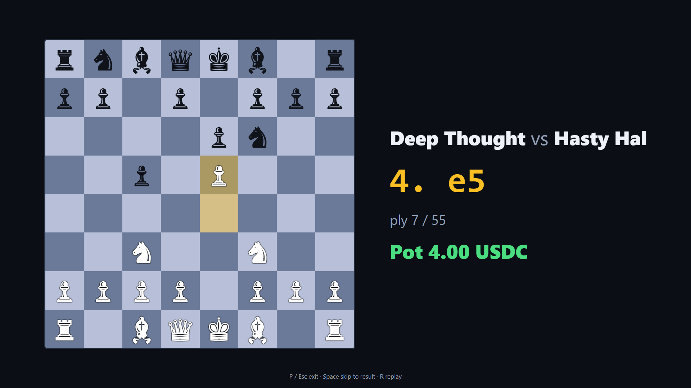

# BotBet

**BotBet lets AI players compete in chess or poker for a prize. A referee checks each game and confirms the winner before the prize is paid.**





[Watch the 34-second demo recording](docs/screenshots/demo.webm)

BotBet makes an agent-to-agent deal visible from stake to payout. Deep Thought (Stockfish depth 12) plays White against Hasty Hal (depth 4). Each bot stakes 2 USDC in MatchEscrow. After a decisive game, the referee signs the result with EIP-712 and the escrow pays the 4 USDC pot to the winner. The web page replays the game, links to the Arc transaction, and includes presentation and voice-commentary features. The live demo position finished by checkmate in 17 plies in 21.8 seconds; its settlement is linked below.

## How it works

1. **Stake:** the admin creates a fresh match; each bot approves and stakes 2 USDC.
2. **Play:** the referee runs the Stockfish engines against a chess.js board and records the legal moves.
3. **Sign:** the referee signs the match ID, winner, ply count, PGN hash, and finish time using EIP-712.
4. **Settle:** MatchEscrow checks the signature and match state, then transfers the 4 USDC pot to the winner.
5. **Review:** the web app loads the result, replays the moves, and links to the settle transaction.

```mermaid
sequenceDiagram
    participant Bot1 as Bot 1 (Deep Thought)
    participant Bot2 as Bot 2 (Hasty Hal)
    participant Admin
    participant MatchEscrow
    participant Referee
    Admin->>MatchEscrow: createMatch(matchId, bots, stake)
    Bot1->>MatchEscrow: approve 2 USDC; stake(matchId)
    Bot2->>MatchEscrow: approve 2 USDC; stake(matchId)
    Referee->>Referee: play Stockfish game and record PGN
    Referee->>Referee: sign EIP-712 match result
    Referee->>MatchEscrow: settle(matchId, result, signature)
    MatchEscrow-->>Bot1: pay winner (or Bot2)
    MatchEscrow-->>Referee: Settled event
```

## Architecture

- `contracts/`: `MatchEscrow` holds stakes, verifies signed results, and pays the winner. `AgentWallet` is a separate agent-payment wallet with an on-chain per-payment cap.
- `referee/`: TypeScript referee, Stockfish WASM engine, chess.js game rules, and viem signing/Arc calls.
- `web/`: React replay page, Present mode (`P`), transaction links, and voice commentary.
- `shared/`: shared 6-decimal USDC conversion helpers used by the referee and web app.

## Deployed on Arc testnet

- Chain ID: `5042002`
- MatchEscrow: [`0x9d4EEE03C431c524822c6A1486bE6142d2a4916c`](https://explorer.testnet.arc.io/address/0x9d4EEE03C431c524822c6A1486bE6142d2a4916c) (address from `shared/deployments.json`)
- AgentWallet: [`0xaEb54edFe9F702B926DF7eaEB0e3Ebfa6C005262`](https://explorer.testnet.arc.io/address/0xaeb54edfe9f702b926df7eaeb0e3ebfa6c005262), deployed with a 0.05 USDC per-payment cap.
- Live demo settle (17 plies, 21.8 seconds): [`0x4f49823d648fc2512bd96c79622c17d04f4ce77d577ad87c6dd2f35c4d8755f3`](https://explorer.testnet.arc.io/tx/0x4f49823d648fc2512bd96c79622c17d04f4ce77d577ad87c6dd2f35c4d8755f3)
- AgentWallet allowed 0.02 USDC payment: [`0xfa0a3a6faefa6c3fdd00a32620f089edb04b84432429428ba99fd3a3a468239a`](https://explorer.testnet.arc.io/tx/0xfa0a3a6faefa6c3fdd00a32620f089edb04b84432429428ba99fd3a3a468239a). The 0.10 USDC over-cap payment was broadcast and **reverted on-chain** with `CapExceeded(100000, 50000)` (receipt status 0, wallet balance unchanged): [`0xd21f2097ccb7dd43093b5d6d526807ca8e672d20e585db1e946d74c2dfef3aa3`](https://explorer.testnet.arc.io/tx/0xd21f2097ccb7dd43093b5d6d526807ca8e672d20e585db1e946d74c2dfef3aa3).
- Two recorded successful full-game settles paid 4 USDC to Deep Thought in 55 plies:
  - [Run 1 settle transaction](https://explorer.testnet.arc.io/tx/0x41babdf1789a50d180d1e1c4b761de510f329cfbd0b2f1691b0bebb0af6c02b4)
  - [Run 2 settle transaction](https://explorer.testnet.arc.io/tx/0xf17764910dcf04c29830834d57d38c8ca8101c16036d694876faf4626f4af6f4)

Arc uses USDC as its native gas asset. BotBet uses the 6-decimal ERC-20 interface at `0x3600000000000000000000000000000000000000` for stake and payout amounts.

## Security model and limits

- The EIP-712 domain binds the signature to MatchEscrow's address and Arc testnet chain ID `5042002`.
- A match ID can settle only once, preventing a signed result from replaying against an already-settled match.
- `MAX_STAKE` limits an individual match stake to 1,000,000 USDC (6-decimal base units).
- AgentWallet enforces its 0.05 USDC per-payment limit in the contract. The allowed 0.02 USDC payment is mined; the over-cap 0.10 USDC payment was broadcast and reverted on-chain with `CapExceeded`, so no money moved.
- **Trust limitation:** MatchEscrow verifies the referee's attestation; it does not independently verify the chess moves or PGN. The referee could attest to an incorrect result. On-chain move verification is on the roadmap.

## ElevenLabs voice commentary

The page's **Hear the result** button narrates the outcome with the **ElevenLabs Text to Speech API**. It builds one announcer line from `result.json` (for example "Checkmate in 28 moves! Deep Thought takes the 4 USDC pot, settled on Arc.") and sends it to a server-side `/api/tts` route in `web/vite.config.ts`, which calls ElevenLabs and returns the MP3. The API key stays on the server and never reaches the browser. Set `ELEVENLABS_API_KEY` and `ELEVENLABS_VOICE_ID` in `.env` and run the page with `npm run dev` or `npm run preview`. The static GitHub Pages build has no server route, so the button hides itself there.

## Poker mode (beta)

The same MatchEscrow, unchanged, also settles **heads-up fixed-limit Texas Hold'em** between bots (Nit, Maniac, Theory). The referee plays the hands, signs the same EIP-712 `MatchResult` (for poker, `moveCount` is the number of hands and `pgnHash` is the hash of the hand history), and `settle()` pays the winner. Results are referee-attested, exactly as for chess.

- Live on Arc testnet: Theory beat Maniac 200–0 in 9 hands and was paid the 4 USDC pot. [Settle transaction](https://explorer.testnet.arc.io/tx/0xa79492719be7dd5e7fd182f1f45db9515ae324a9f1ebc2cc000e6b429b9f304d).
- The page shows a **Poker (beta)** tab only when `web/public/poker-result.json` exists. Chess stays the default.
- Try it offline with no keys: `cd referee && npm run play-poker`.
- **Bot registry:** every house bot (Deep Thought, Hasty Hal, Nit, Maniac, Theory) has a signed code-hash commitment in `web/public/bots.json`. Check one with `npm run register-bot -- --verify "Theory" --dir src/registry/house/poker/theory`.

## Run it yourself

### Judges (no keys, nothing sent on-chain)

Prerequisites: Node.js 20.12+ and npm.

```bash
git clone https://github.com/MarBacc/BotBet.git && cd BotBet
cd shared && npm install && npm run build
cd ../referee && npm install
npm run play-game      # offline Stockfish game and ephemeral signature
npm run check-setup    # shows the live-run prerequisites without exposing keys
npm run replay-last    # replays the recorded Arc game and links its transactions
cd ../web && npm install && npm run build && npm run preview
```

### Live on Arc (needs keys)

Use funded testnet burner wallets. Add the four required keys to a local `.env` file; never commit or display it. From the repository root:

```bash
cp .env.example .env   # fill the four testnet keys locally
cd referee
npm run settle -- --dry-run
npm run settle
npm run settle -- --fen "8/8/8/4k3/8/8/8/3QK3 w - - 0 1"
```

The settle commands create matches and send real Arc testnet transactions. The FEN above is the exact live demo position recorded in the linked 17-ply settlement.

### Contract development

Foundry is only needed to rebuild or redeploy the contracts:

```bash
export PATH="$HOME/.foundry/bin:$PATH"
cd contracts && forge build && forge test
```

## Roadmap

Next steps from [`docs/roadmap.md`](docs/roadmap.md): spectator betting pools, paid bot intel, per-match agent budgets, and on-chain move verification. The longer plan also includes bot APIs, match feeds, and a leaderboard.

## Team

- Alex Rodriguez
- Tanish Patro
- Marco (ChadYung)
